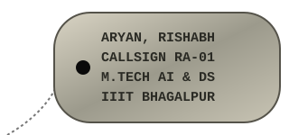
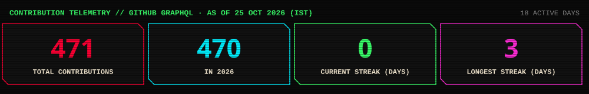

<div align="center">


</div>

<p align="center"><b>Rishabh Aryan</b> · AI/ML researcher and R&amp;D engineer · M.Tech in Artificial Intelligence &amp; Data Science, IIIT Bhagalpur · machine learning, deep learning, wind power forecasting, quantum machine learning, explainable AI (SHAP, LIME), real estate price prediction, NLP and healthcare AI · Python, scikit-learn, PyTorch, FastAPI</p>

<table><tr><td width="62%">

```text
> mission_briefing --operator RA-01
  NAME     Rishabh Aryan
  ROLE     AI/ML Researcher & R&D Engineer
  BASE     M.Tech, AI & Data Science @ IIIT Bhagalpur
  AFFIL    IIIT Bhagalpur · IIT Jammu Summer School 2026
           · IIT Ropar × NIELIT Ropar
  OBJECTIVE
    Machine learning that holds up under scrutiny:
    leakage-aware benchmarks, honest evaluation,
    reproducible research code.
```

</td><td align="center">



</td></tr></table>


<a href="https://github.com/Rishabh-bgp/cobratate"></a>

> **🎯 Internship: AI (LLMs, GenAI, Automation & AI Agents)** · Summer School 2026, **IIT Jammu**, in collaboration with
> **Techible** and **I3C IIT Jammu** · **10 Jun – 10 Aug 2026**
>
> **Hackathon op:** built [**Cobratate**](https://github.com/Rishabh-bgp/cobratate), an esoteric programming language
> with a Python interpreter, in a **24-hour hackathon** at IIT Jammu. [▶ Try it live](https://rishabh-bgp.github.io/cobratate/)


| Sector | Mission |
|---|---|
| 🧠 **EEG / epilepsy detection** | Provenance audits and leakage-aware seizure-type classification |
| 🧬 **Cancer genomics ML** | Tumour-type classification on RNA-Seq with conformal reliability |
| 🛡️ **NLP spam & scam detection** | Explainable SMS/email scam detection for English, Hindi and Hinglish |
| 🌐 **Web development** | Modern UI/UX websites and browser games in plain HTML, CSS and JavaScript |


### `> SECTOR 01 :: IIT ROPAR × NIELIT ROPAR AI/ML PROGRAM`

| Project | What it is | Live |
|---|---|---|
| [**beed-ml-study**](https://github.com/Rishabh-bgp/beed-ml-study) | Provenance audit & leakage-aware benchmark on the Bangalore EEG Epilepsy Dataset | — |
| [**pan-cancer-classification**](https://github.com/Rishabh-bgp/pan-cancer-classification) | Leakage, equivalence & conformal reliability on UCI TCGA Pan-Cancer RNA-Seq | — |
| [**real-estate-valuation-taiwan**](https://github.com/Rishabh-bgp/real-estate-valuation-taiwan) | Capstone: house price per ping prediction for Xindian, New Taipei — gradient boosting, FastAPI, in-browser web app with OpenStreetMap | [▶ open](https://rishabh-bgp.github.io/real-estate-valuation-taiwan/) |
| [**boston-house-price-prediction**](https://github.com/Rishabh-bgp/boston-house-price-prediction) | Capstone: Boston home-value prediction — gradient boosting with the race feature B excluded, FastAPI, in-browser web app | [▶ open](https://rishabh-bgp.github.io/boston-house-price-prediction/) |
| [**california-house-price-prediction**](https://github.com/Rishabh-bgp/california-house-price-prediction) | Capstone: California block-group value prediction: gradient boosting, spatial CV, $500k cap handled, FastAPI, Leaflet map app | [▶ open](https://rishabh-bgp.github.io/california-house-price-prediction/) |
| [**iris-classification**](https://github.com/Rishabh-bgp/iris-classification) | Iris classifier: scikit-learn model comparison, FastAPI `/predict`, Docker, CI and an in-browser ML demo | [▶ open](https://rishabh-bgp.github.io/iris-classification/) |
| [**machine-learning-part-1**](https://github.com/Rishabh-bgp/machine-learning-part-1) | Heart-disease classification & insurance-cost regression with scikit-learn | — |
| [**NIELIT-MACHINE-LEARNING-PROJECTS**](https://github.com/Rishabh-bgp/NIELIT-MACHINE-LEARNING-PROJECTS) | Nineteen end-to-end ML projects with runnable notebooks | — |

### `> SECTOR 02 :: FIELD OPERATIONS`

| Project | What it is | Live |
|---|---|---|
| [**spam-scan**](https://github.com/Rishabh-bgp/spam-scan) | Explainable spam/phishing/Indian-scam detector (TF-IDF + LR, Flask) | [▶ open](https://spam-scan.onrender.com) |
| [**cobratate**](https://github.com/Rishabh-bgp/cobratate) | Esoteric programming language with a Python interpreter — built at a 24-hour hackathon at IIT Jammu | [▶ open](https://rishabh-bgp.github.io/cobratate/) |
| [**logistics-website-capstone**](https://github.com/Rishabh-bgp/logistics-website-capstone) | Kargonaut Logistics — claymorphism, glassmorphism & neumorphism | [▶ open](https://rishabh-bgp.github.io/logistics-website-capstone/) |
| [**lovelight-leap**](https://github.com/Rishabh-bgp/lovelight-leap) | Love-themed 2D platformer in vanilla JS canvas | [▶ play](https://rishabh-bgp.github.io/lovelight-leap/) |


<div align="center">

**Industry capstone with KF Property Network Pte Ltd (KFPN), a Knight Frank Singapore subsidiary**

</div>

| Part | Operation | Theatre | Live | Deployed model (repeated K-fold CV) |
|:---:|---|---|---|---|
| ◆ I | [**real-estate-valuation-taiwan**](https://github.com/Rishabh-bgp/real-estate-valuation-taiwan) | Xindian, New Taipei · 414 sales | [▶ open](https://rishabh-bgp.github.io/real-estate-valuation-taiwan/) | R² **0.715** · RMSE 7.136 · MAE 4.551 (10k TWD/ping) |
| ◆ II | [**boston-house-price-prediction**](https://github.com/Rishabh-bgp/boston-house-price-prediction) | Boston, USA · 506 tracts | [▶ open](https://rishabh-bgp.github.io/boston-house-price-prediction/) | R² **0.877** · RMSE 3.157 · MAE 2.119 ($1000s) |
| ◆ III | [**california-house-price-prediction**](https://github.com/Rishabh-bgp/california-house-price-prediction) | California, USA · 20,640 block groups | [▶ open](https://rishabh-bgp.github.io/california-house-price-prediction/) | R² **0.840** · RMSE 0.461 · MAE 0.291 ($100k) |

<sub>Personal portfolio projects on public datasets, text credit only. They are not endorsed by, or official products of, KFPN or Knight Frank.</sub>


## M.Tech in AI and Data Science, IIIT Bhagalpur: Thesis Work

Wind power forecasting reference implementations: clean Python rebuilds on synthetic data, because the original SCADA data is confidential. Results will differ from the published papers.

### `> TRACK A :: RISHABH`

| | Repository | What it is | Live |
|:---:|---|---|---|
| `☰` | [**hybrid-vqc-wind-speed-forecasting**](https://github.com/Rishabh-bgp/hybrid-vqc-wind-speed-forecasting) | Hybrid variational quantum circuit (Conv1D-LSTM + VQC) wind speed forecasting, PyTorch + PennyLane | [▶ open](https://rishabh-bgp.github.io/hybrid-vqc-wind-speed-forecasting/) |
| `☱` | [**cbma-tn-vqc-wind-green-hydrogen**](https://github.com/Rishabh-bgp/cbma-tn-vqc-wind-green-hydrogen) | CNN-BiLSTM-MultiHead attention + tensor network + VQC for wind forecasting and green hydrogen | [▶ open](https://rishabh-bgp.github.io/cbma-tn-vqc-wind-green-hydrogen/) |
| `☲` | [**hcq-lstm-clqgwo-wind-forecasting**](https://github.com/Rishabh-bgp/hcq-lstm-clqgwo-wind-forecasting) | Physics-informed hybrid classical-quantum LSTM tuned by a chaotic Lévy-flight quantum-inspired grey wolf optimiser | [▶ open](https://rishabh-bgp.github.io/hcq-lstm-clqgwo-wind-forecasting/) |
| `☳` | [**rso-net-wind-grid-stabilization**](https://github.com/Rishabh-bgp/rso-net-wind-grid-stabilization) | RSO-Net: recursive self-optimising TCN-attention probabilistic forecasting with human-approved grid-stabilisation proposals | [▶ open](https://rishabh-bgp.github.io/rso-net-wind-grid-stabilization/) |

### `> TRACK B :: SARAH`

| | Repository | What it is | Live |
|:---:|---|---|---|
| `☴` | [**geoai-hybrid-ga-pso-anfis-wind-forecasting**](https://github.com/Rishabh-bgp/geoai-hybrid-ga-pso-anfis-wind-forecasting) | GeoAI hybrid GA → PSO → ANFIS → CNN-LSTM probabilistic multi-site wind forecasting | repo live · demo pending |
| `☵` | [**xai-shap-lime-cnn-bilstm-attention-wind**](https://github.com/Rishabh-bgp/xai-shap-lime-cnn-bilstm-attention-wind) | Explainable wind speed forecasting: SHAP, LIME and attention on a CNN-BiLSTM-Attention model | repo live · demo pending |
| `☶` | [**wuweidl-daoist-gated-wind-forecasting**](https://github.com/Rishabh-bgp/wuweidl-daoist-gated-wind-forecasting) | WuWeiDL: Wu Wei gating and Feng-Qi turbulence encoding for wind speed forecasting | repo live · demo pending |
| `☷` | [**iot-n8n-wind-turbine-predictive-maintenance**](https://github.com/Rishabh-bgp/iot-n8n-wind-turbine-predictive-maintenance) | IoT + forecasting + n8n automation for wind-turbine predictive maintenance | repo live · demo pending |
| `☰` | [**multi-agent-turbine-fleet-chief-of-staff**](https://github.com/Rishabh-bgp/multi-agent-turbine-fleet-chief-of-staff) | Multi-agent "AI chief of staff" for wind-turbine fleet operations | repo live · demo pending |

<!-- TRACK C :: MARIYA (5 repos, not published yet). To add: copy a TRACK block above, set the heading to
     "### `> TRACK C :: MARIYA`", add one table row per repo, then bump THESIS REPOS in assets/scorecard.svg. -->


<p align="center">
  
</p>

`pandas` · `NumPy` · `LightGBM` · `matplotlib` · `seaborn` · `Jupyter`


| Period | Programme |
|---|---|
| — | **M.Tech, Artificial Intelligence & Data Science** — Indian Institute of Information Technology (IIIT) Bhagalpur |
| — | **6-Month Industrial Training & Certification Program in AI & ML** — jointly offered by [IIT Ropar](https://www.iitrpr.ac.in/) and [NIELIT Ropar](https://www.nielit.gov.in/ropar/), under MeitY, Govt. of India |
| 10 Jun – 10 Aug 2026 | **Internship: AI (LLMs, GenAI, Automation & AI Agents)** — Summer School 2026, IIT Jammu, in collaboration with Techible and I3C IIT Jammu. During this internship I built [**Cobratate**](https://github.com/Rishabh-bgp/cobratate) at a 24-hour hackathon at IIT Jammu. |


## Publications

51 entries from [`publications.csv`](publications.csv): papers, book chapters, books, patents and a copyright registration. Grouped by year, newest first.

### `> 2026` · 40 entries

**Papers, chapters and books (36)**

- Towards Immersive Classrooms: Practical Approaches to AR and VR Adoption in Indian Educational Institutions. **Aryan, Er. Rishabh**. *The Future of Engineering Innovations: Smart Technologies and Advanced Design @ 2026*, vol. 3, p. 103, Chyren Publications, 742, Ground Floor, Maruti Chowk, Ghitorni, Delhi-30.
- Automated Multi-Class Chest X-Ray Classification: A Hybrid cGAN-Transfer Learning Framework for Detecting Normal, Tuberculosis, Pneumonia, and COVID-19 Severity Levels. **Aryan, Er. Rishabh**. *The Future of Engineering Innovations: Smart Technologies and Advanced Design @ 2026*, vol. 3, p. 121, Chyren Publications, 742, Ground Floor, Maruti Chowk, Ghitorni, Delhi-30.
- Predicting Student Dropout and Satisfaction in Virtual Learning Environments: A Comparative Study of ML Algorithms. **Aryan, Er. Rishabh**. *The Future of Engineering Innovations: Smart Technologies and Advanced Design @ 2026*, vol. 3, p. 136, Chyren Publications, 742, Ground Floor, Maruti Chowk, Ghitorni, Delhi-30.
- Predictive Maintenance for Construction Sites: Leveraging IoT and AI for Minimizing Downtime. **Aryan, Er. Rishabh**. *International Journal of Engineering Development and Research*.
- Chronic Kidney Disease Stage Identification in HIV Infected Patients Using Supervised Machine Learning: A Review. **Aryan, Er. Rishabh**. *International Journal of Versatile Research and Analysis*.
- Comparative Analysis of Traditional Machine Learning Algorithms for Text Classification in Natural Language Processing: A Study of Naive Bayes, Random Forest, and Support Vector Machine with TF-IDF Vectorization. **Aryan, Er. Rishabh**. *High Technology Letters*.
- Machine Learning-Based Fault Detection and Recovery Prediction in Digital Microfluidic Biochips: An Integrated XGBoost-SMOTE Framework. **Aryan, Er. Rishabh**. *Xi'an Jianzhu Keji Daxue Xuebao/Journal of Xi'an University of Architecture and Technology*.
- Mathematical Modeling and Image Processing Techniques for Early Detection of Tumor Heterogeneity in Medical Imaging. Dr. C. Balaji, **Er. Rishabh Aryan**, Rachit Ahuja, Dr. Prabhat Bansal, Dr. Krishnan Bandyopadhyay, Prem Kumar. *Scientific Culture*.
- Hybrid Deep Learning Models with Attention Mechanisms for Short-Term Wind Speed Forecasting: A Comprehensive Review and Benchmarking of CNN–BiLSTM–Attention Using Synthetic SCADA-Style Data for Robust Preliminary Validation. **Er. Rishabh Aryan**, Prof. Dr. Tryambak Hiwarkar. *International Journal of Multidisciplinary Engineering in Current Research (IJMEC)*.
- Hybrid Deep Learning Models with Attention Mechanisms for Short-Term Wind Speed Forecasting: A Comprehensive Review and Benchmarking of CNN–BiLSTM–Attention on Real SCADA Data. **Er. Rishabh Aryan**, Prof. Dr. Tryambak Hiwarkar. *International Journal of Multidisciplinary Engineering in Current Research (IJMEC)*.
- Performance Benchmarking of a Novel CNN–BiLSTM–Attention Hybrid Model for Short-Term Spatiotemporal Wind Speed Forecasting Using Indian SCADA Data. **Er. Rishabh Aryan**, Prof. Dr. Tryambak Hiwarkar. *International Journal of Engineering and Science Research (IJESR)*.
- A Unified GeoAI Hybrid Framework for African Windscapes: Integrating Evolutionary Swarm, Fuzzy-Neuro Computing, and Probabilistic Spatio-Temporal Wind Forecasting for Sustainable Regional Energy Planning. **Er. Rishabh Aryan**, Prof. Dr. Tryambak Hiwarkar. *African Journal of Geography and Regional Planning (Ajgrp)*.
- Explainable AI for Wind Speed Forecasting: SHAP and LIME Interpretability of the CNN–BiLSTM–Attention Model on Real-World Indian Wind Farm Data. **Er. Rishabh Aryan**, Manimozhi I. *Journal of African Development (JAD)*.
- Mathematical Formulations, Optimization, and Statistical Validation of Hybrid Deep Learning Models for Short-Term Wind Speed Forecasting: A Comparative Analysis of ANN, LSTM, SVM, ARIMA-ANN, CNN-BiLSTM, and CNN-BiLSTM-Attention Architectures. **Er. Rishabh Aryan**, Manimozhi I. *International Journal for Research in Advanced Computer Science and Engineering*.
- Modeling and Forecasting of Wind Speed Using ARIMA and SARIMA Models: An Empirical Study of Chennai City. **Er. Rishabh Aryan**, Manimozhi I. *International Journal for Research in Advanced Computer Science and Engineering*.
- Enhancing Dermatological Diagnosis Through Multimodal Deep Learning and Visual–Textual Data Fusion. I. Manimozhi, D. Lakshmi, **Er. Rishabh Aryan**. *Revista Latinoamericana de la Papa*.
- Neuro-Symbolic Deep Learning for Interpreting Pre-Columbian Geoglyphs and Rock Art in the Brazilian Amazon: Implementation of a Multimodal Model, Explainability Analysis, and Governance Frameworks for Indigenous Cultural Sovereignty. **Aryan, Er. Rishabh**. *Revista Latinoamericana de la Papa*.
- Trust, Explainability, and Workflow Integration of Multimodal AI in Dermatology: Insights from Indian Dermatologists. **Er. Rishabh Aryan**, Manimozhi I. *International Journal of Engineering Development and Research*.
- Revolutionising Dental Care Through Artificial Intelligence: Applications in Oral Surgery and Diagnostics. **Er. Rishabh Aryan**, Prof. Dr. Tryambak Hiwarkar. *Revista Latinoamericana de la Papa*.
- Machine Learning Applications in Autism Spectrum Disorder Therapy: Personalized Intervention Planning, Behavioral Monitoring, and Outcome Prediction. **Er. Rishabh Aryan**, Prof. Dr. Tryambak Hiwarkar. *Revista Latinoamericana de la Papa*.
- Riding the Wind Like Liezi: Re-Embodying Daoist Wu Wei and Feng-Qi Dynamics in Hybrid Deep Learning Models for Ultra-Accurate Wind Speed Forecasting. **Er. Rishabh Aryan**, Manimozhi I. *Multidisciplinary Journal of Academic Publications*.
- Wind Speed Forecasting Using Quantum Computing: A Hybrid Variational Quantum Circuit Approach on Indian SCADA Data. **Er. Rishabh Aryan**, Sonam Eyden. *Engineering Universe For Scientific Research And Management*.
- Introduction to AI and Machine Learning for Modern Systems. **Aryan, Er. Rishabh**. Intellect Jurists Publishers - International Publishers and Distributors (India).
- Quantum-Classical Hybrid Intelligence for the Green Hydrogen Revolution: Quantum-Inspired Tensor Networks and Variational Quantum Circuits Integrated with CNN-BiLSTM-Multihead Attention for Hyper-Accurate Wind Speed Forecasting and Real-Time Electrol. **Er. Rishabh Aryan**, Sonam Eyden, Manimozhi I, Dr. Tryambak Hiwarkar. *Tanz Research Journal*.
- A Retrieval-Augmented Large Language Model Framework for Intelligent Maritime Decision Support Systems. I. Manimozhi, D.Lakshmi, A.Akila, **Rishabh Aryan**. *Amet Global Maritime Summit (AGMS 2026)*, 1(1), p. 255.
- Physics-Informed Hybrid Classical-Quantum LSTM Network for Wind Speed Forecasting, Optimized via a Chaotic Lévy-Flight Quantum-Inspired Grey Wolf Metaheuristic. **Aryan, Rishabh**. *International Conference on Multidisciplinary Research and Global Perspectives (ICMRIGP 2026)*.
- Physics-Informed Hybrid Classical-Quantum LSTM Network for Wind Speed Forecasting, Optimized via a Chaotic Lévy-Flight Quantum-Inspired Grey Wolf Metaheuristic. **Aryan, Rishabh**. *Dianwang Jishu/Power System Technology*, 50(3), pp. 245 - 279, Power System Technology Press.
- Artificial Intelligence Applications in Modern Defense Strategy and Decision Making Processes. **Aryan, Er. Rishabh**. *Artificial Intelligence: Theory, Techniques, and Real-World Integration V6B77*, vol. 1, pp. 100-109, Iterative International Publishers (IIP Series).
- Mathematical Foundations of AI. **Aryan, Rishabh**. *Artificial Intelligence: Theory, Techniques, and Real-World Integration V6B77*, vol. 1, pp. 86-99, Iterative International Publishers (IIP Series).
- Integration of Real Time IoT Sensor Networks and Advanced Wind Speed Forecasting Models Within an N8n Based Automation Framework for Predictive Maintenance of Wind Turbines and Enhanced Renewable Energy Grid Stability. **Aryan, Er. Rishabh**. *International Journal of Engineering Applied Science and Management*, 7(8), pp. 1-30, IJEASM Assosiation, Bhopal, Madhya Pradesh (India).
- Multi-Agent AI Chief of Staff for Turbine Fleet Operations: Integrating Advanced Wind Speed Forecasting to Optimise Real Time Performance, Maintenance and Grid Integration. **Aryan, Er. Rishabh**. *International Journal of Artificial Intelligence and Computer Electronics*, 2(3), pp. 1-32, IJAICE, Taurusavenue 105 2122 LS, Hoofddorp, Netherlands.
- Recursive Self-Optimizing Neural Architectures for Ultra-High-Resolution Wind Speed Forecasting and Autonomous Grid-Stabilization Protocols Under Extreme Uncertainty. **Aryan, Er. Rishabh**. *International Journal of Artificial Intelligence and Communication Networks*, 2(3), pp. 5-29, U.S. Center for Scholarly Excellence, 265 E River Park Circle, 1st Floor ….
- From Rule-Based Systems to Retrieval-Augmented LLMs: A Comparative Review of AI Approaches for Maize Pest and Disease Management in Punjab. **Rishabh Aryan**, Anju, Satpal, Nishtha Kalia, Dr. Sarwan Singh. *Cadernos de Pós-Graduação em Direito Político e Econômico*, 26(2), pp. 1069-1092, Centro de Estudos Acadêmicos Press (Center for Academic Studies Press).
- Wind-Aware Multi-Agent UAV Coordination for Targeted Pesticide Application: A Chemical Exposure and Occupational Health Risk Assessment for Fall Armyworm Management in Spring Maize, Punjab. **Rishabh Aryan**, Anju, Satpal, Nishtha Kalia, Dr. Sarwan Singh. *Journal of Chemical Health Risks (JCHR)*, 16(5), pp. 169-188, Islamic Azad University.
- A Hybrid CNN-Vision Transformer Framework for Multi-Class Plant Disease Identification from Leaf Images. **Rishabh Aryan**, Anju. *Journal of Machine Learning Innovations and Artificial Intelligence Horizons*, 1(2), pp. 153-171, Notation Trendplus Publishing Pvt. Ltd.
- Integrating Digital Agriculture and Smart Farming Technologies for Climate-Smart Crop Management: A Field-Based Evaluation of AI, IoT, and Precision Systems. **Rishabh Aryan**, Anju. *Journal of Environmental Agriculture and Agroecosystem Management*, vol. 1, Vol. 1 No. 1 (2026): October, pp. 165-183, Notation Trendplus Publishing Pvt. Ltd.

**Patents and copyright (4)**

- Wearable Sensor for Sports and Medical Use. Dr. CMA. Nayankumar Manilal Malde, Mr. Bhaskar J. Raskar, Maj. Dr Rahul Dilipkumar Magdum, Nishant Bharti, **Er. Rishabh Aryan**, Dr. Gitam Singh, Dr. Phatangare Ambadas Somnath, Dr. Mohit Kumar. Patent 496859-001 (IN).
- AI-Based Autonomous Multi-Agent Cyber Threat Detection and Response System. Vivek Kothuru, Dr. R Sarath Babu, Dr. Roshan Suresh Bhanuse, Dr. Shyamal Mandal, **Er. Rishabh Aryan**, Dr. P. Ramasubramanian. Patent 510316-001 (IN).
- Embodying Wu Wei and Ziran in Comptemporary Practice: Daoist Philosophical Principles Applied to a Hybrid CNN-BiLSTM-Attention Model for Spatiotemporal Wind Speed Forecasting-Insights from Indian SCADA Data, Chennai ARIMA/SARIMA Analysis, and African. **Aryan, Er. Rishabh**. *Government of India (Copyright Office)*, LD-34737/2026-CO.
- Hybrid Mechanical Waste-to-Energy Processing System. Shende, Prashant N., Chowdhury, Prasun, Gaikwad, Amol Dilipkumar, **Aryan, Rishabh**, Tolani, Smita Chandar, Ravi, S. Robert. Patent 20,262,107,892 (IN).

### `> 2025` · 2 entries

**Papers, chapters and books (2)**

- Investigation of Farmer Livelihoods and the Role of Digital Technologies in Empowering Rural Communities in Bhagalpur, Bihar, India. **Rishabh Aryan**, Abdul Kalam. *Revista Latinoamericana de la Papa*.
- Early-Stage Hot Event Prediction in Social Networks Using a Bayesian Modeling Framework. **Er. Rishabh Aryan**, Dr. Bhanu Priya. *International Journal of Information Technology and Computer Engineering*.

<details>
<summary><b><code>&gt; 2024</code> · 6 entries</b> (click to expand)</summary>

**Papers, chapters and books (6)**

- Comprehensive Survey of Evolution of User Interface Banking and Financial Services Industry. **Rishabh Aryan**, Mr. Abdul Kalam. *International Research Journal of Humanities and Interdisciplinary Studies*.
- Designing Bio-Inspired Clay Bricks for Sustainable Construction: Harnessing Nature's Design for Reduced Environmental Impact and Enhanced Performance. **Rishabh Aryan**, Mrs. Mahima Yadav, Mr. Abdul Kalam. *International Journal of Advance Research and Innovative Ideas in Education*.
- Optimization of the Brick Making Process: Identifying Pain Points and Opportunities for Improvement in Bhagalpur, Bihar. **Rishabh Aryan**, Er. Chandan Kumar Pandey, Dr. Jaswinder Kaur. *International Journal of Advance Research and Innovative Ideas in Education*.
- IoT-Driven Parking Solution to Enhance DIT University’s Infrastructure. Ishaan Chaudhary, **Rishabh Aryan**, Abhishek Parmar, Gopal Lohar. *International Journal of Original Recent Advanced Research*.
- Enhancing Government-Citizen Interaction: Bridging Service Gaps Through Digital Design Solutions in Bihar, India. **Rishabh Aryan**, Abdul Kalam. *Revista Latinoamericana de la Papa*.
- Connecting the Dots: Mapping & Mastering the TSDPL Customer Experience. **Rishabh Aryan**, Abdul Kalam, Mahima Yadav, Subhash Chandra Pandey. *Revista Latinoamericana de la Papa*.

</details>

<details>
<summary><b><code>&gt; 2023</code> · 1 entry</b> (click to expand)</summary>

**Papers, chapters and books (1)**

- A Study on Digital Marketing and its Impact on Revenue Generation. **Rishabh Aryan**, Poonam Gupta. *Revista Latinoamericana de la Papa*.

</details>

<details>
<summary><b><code>&gt; 2022</code> · 2 entries</b> (click to expand)</summary>

**Papers, chapters and books (2)**

- Dakshin Bihar Gramin Bank: Redefining the Digital Banking Experience with a Unified UI. **Rishabh Aryan**, Poonam Gupta. *Revista Latinoamericana de la Papa*.
- To Study the Insurance Claims Detection Using Machine Learning. **Rishabh Aryan**, Amit Kumar Sahu. *Revista Latinoamericana de la Papa*.

</details>


<p align="center">
  
  
</p>

<sub>The contribution card is generated from GitHub's GraphQL API by <code>scripts/contrib_card.py</code> and refreshed daily by a GitHub Action, so it does not depend on third-party image caches.</sub>

```text
> sitrep
  ALL SYSTEMS ONLINE — open to research collaborations in applied ML.
```
